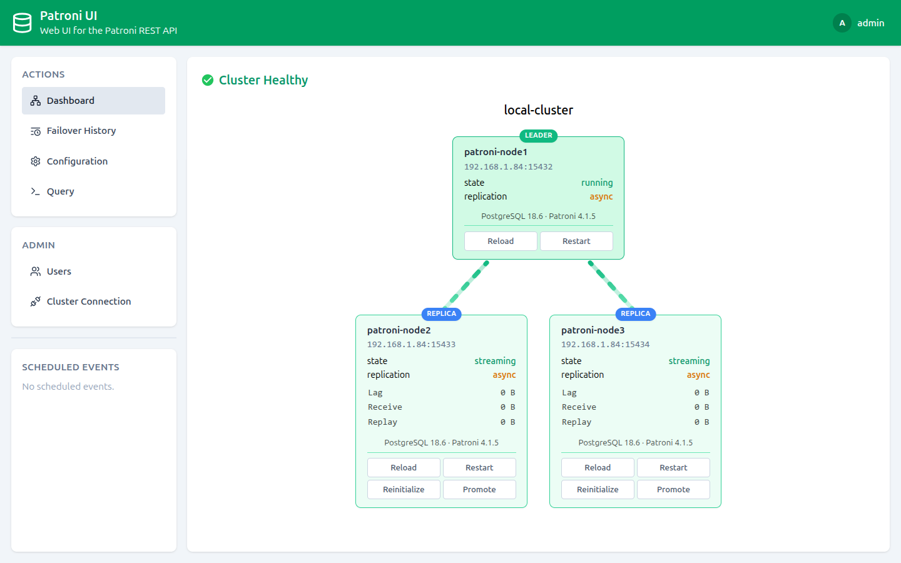

# Patroni UI

**Patroni UI** is a web interface for [Patroni](https://github.com/zalando/patroni)-managed
PostgreSQL clusters — monitor, manage and operate your cluster entirely from the browser.
Built on the [`go-patroni`](https://github.com/pgsty/go-patroni) SDK.



> [!NOTE]
> This project was created mostly by an LLM agent for personal use by
> [@armantarkhanian](https://github.com/armantarkhanian). No support or bug
> fixes are guaranteed.

## Features

- 🖥️ **Live cluster topology** — see the leader and replicas, their state, replication lag and sync mode in real time.
- 👑 **Switch the leader** — promote a replica or trigger a failover in a couple of clicks.
- ⚙️ **Dynamic configuration editor** — view and edit Patroni's dynamic configuration as JSON with syntax highlighting.
- 🔄 **Node actions** — restart, reload or reinitialize any node, with optional scheduling.
- 📜 **Failover history** — review past leader changes with timeline, LSN and reason.
- 🗄️ **SQL console** — run queries against the leader, a replica or any specific node.
- 📅 **Scheduled events** — schedule and cancel switchovers and restarts.
- 👥 **Multi-user with roles** — admin and read-only users, with per-user PostgreSQL access.
- 🔌 **No config file** — the Patroni connection is set up from the UI (admin only).
- 📦 **Single binary / Docker** — Go backend with an embedded static frontend.

## Run with Docker

### docker run

```sh
docker run -d \
  --name patroni-ui \
  -p 8000:8000 \
  -v "$PWD/patroni-ui-data:/var/lib/patroni-ui" \
  ghcr.io/patroni-ui/patroni-ui:0.1.0
```

### docker compose

```yaml
services:
  patroni-ui:
    image: ghcr.io/patroni-ui/patroni-ui:0.1.0
    container_name: patroni-ui
    restart: unless-stopped
    ports:
      - 8000:8000
    environment:
        LISTEN=0.0.0.0:8000
        DATA_DIR=/var/lib/patroni-ui
    volumes:
      - ./patroni-ui-data:/var/lib/patroni-ui
```

```sh
docker compose up -d
```

Open `http://localhost:8000` and log in. On first start the account is
`admin` / `admin`.

The container listens on `8000` and stores its data in `/var/lib/patroni-ui`
(the `LISTEN` and `DATA_DIR` defaults are baked into the image).

## Users

Web UI accounts are stored in a binary file (`users.db`). It is created
automatically on first start and seeded with the default account
**`admin:admin`**.

Change the admin password (click your avatar → "Change password") and manage
users from the **Admin → Users** page, where an administrator can add, edit and
remove users, grant or revoke admin rights, and configure each user's
PostgreSQL access for the SQL query page.

## Build

The build runs entirely inside Docker, so you don't need Go or Node.js
installed locally:

```sh
make build
```

This produces:

- the Docker image `ghcr.io/patroni-ui/patroni-ui:0.1.0` (and `:latest`);
- `dist/patroni-ui-linux-amd64` — Linux amd64 binary;
- `dist/patroni-ui-windows-amd64.exe` — Windows amd64 binary.

Requirements: Docker (with Buildx, the default builder) and `make`.

Override the image name / version:

```sh
make build IMAGE=yourname/patroni-ui VERSION=0.2.0
```

## Configuration

There is no config file. The application stores all of its state in a data
directory (default `./patroni-ui-data`):

- `users.db` — Web UI accounts (gob binary).
- `cluster.db` — Patroni connection settings (gob binary).

Files are written with `0600` permissions and contain no encryption.

The Patroni cluster connection is configured by an administrator from the UI:
**Admin → Cluster**. The form accepts:

- **Patroni hosts** — a comma-separated list of Patroni REST API base URLs.
- **Username / Password** — optional Basic auth credentials sent to Patroni.
- **Disable TLS verification** — skip certificate verification for the Patroni
  REST API.
- **Certificate** — an optional CA certificate (PEM) used to verify the Patroni
  REST API TLS connection.

Until a cluster is configured, the Dashboard and other pages show a prompt with
an **Add cluster** button (admin only).
